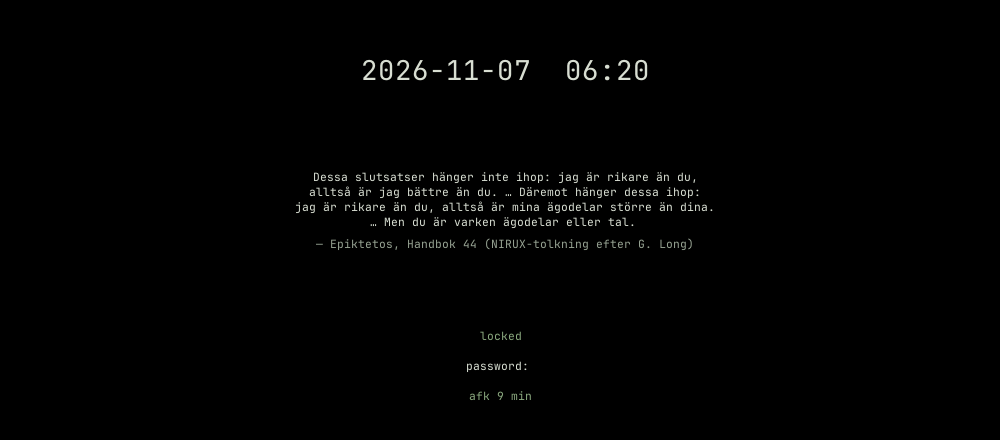
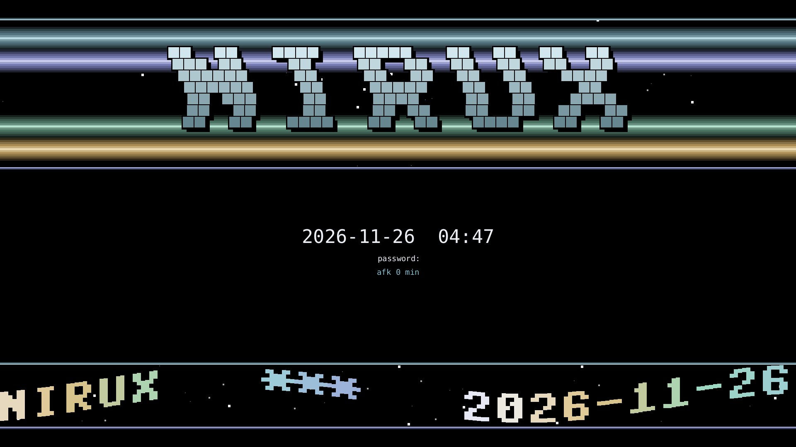
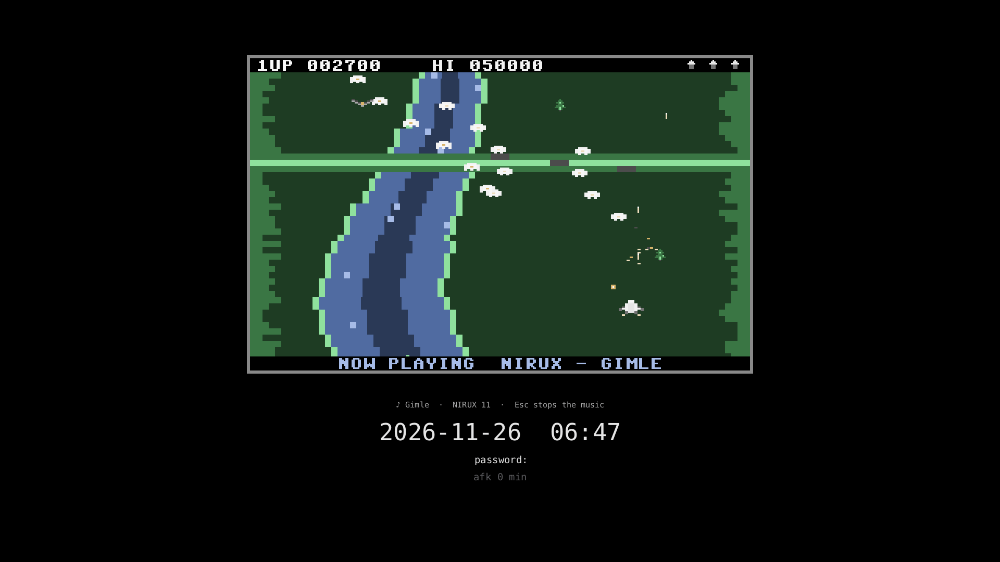
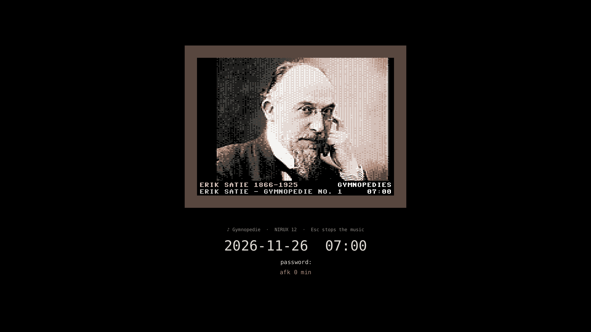
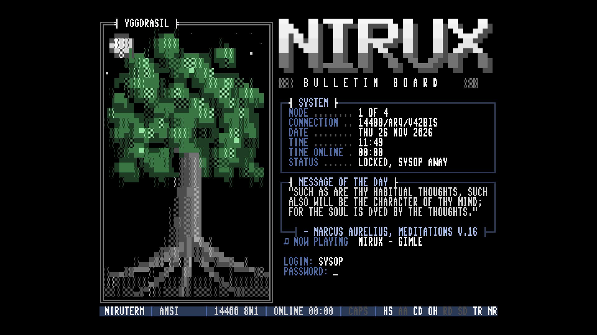

# NIRULOCK

Native X11/PAM lock screen with clock, away time and a themed CAVA spectrum or quotes.

**Status: beta** · Part of the [NIRUX](https://github.com/nirucon/nirux) suite · [MIT License](LICENSE)



## About

NIRULOCK is the lock screen of NIRUX. It authenticates only through PAM, grabs
keyboard and pointer itself and draws a calm, opaque screen in the colours of
the active NIRUX theme: a large clock, how long you have been
away, the password prompt and, while music plays, a live CAVA spectrum. When
it is quiet, it shows a quote from Hávamál or the Stoics instead.

It also publishes `_NIRU_LOCK_READY` once its grabs are verified, which is what
NIRUWM's lock-then-suspend relies on, so the machine never suspends with an
unlocked screen.

## Features

- PAM-only unlock for the process owner; it refuses to start rather than fall
  back to `$USER` or `root`.
- PAM module messages (for example `pam_faillock` lockouts) shown under the
  prompt; failures counted and shown in the theme's warning colour.
- Caps Lock indicator and the active keyboard layout next to the prompt
  (`[SE] password:`) when more than one layout is configured.
- Real XKB input via libxkbcommon (dead keys, AltGr, keypad, compose), loaded
  at run time with a built-in fallback.
- Eleven layouts: `ascii-cava` (default, "NIRUX ascii" with the spectrum), `ascii`, `demo` (a C64 demo: chunky pixel logo, raster bars, sine scroller), `attract` (a C64 shoot 'em up that plays itself, like an arcade game's attract mode), `satie` (a C64 loading screen of Erik Satie, with his Gymnopedie), `bbs` (NIRUX BBS, a dial-up bulletin board in ANSI art, with a modem handshake), `cava`, `minimal`, `terminal`, `runic` and `corner`.
- `visual = "auto"`: CAVA spectrum only while music plays, otherwise rotating
  quotes; CAVA and audio monitoring stop completely with the display off.
- Password-length hiding with `prompt_echo = "pulse"`.
- Every copy of the password is wiped after use; nothing about keys is logged.
- Optional NIRUX sounds through NIRUNOTIFY (`auth-fail`, `lock`, `unlock`,
  and a quiet typewriter click for each password key, `lock-typing`).
- Pause music (`[pause_music]`, on by default, but only when you lock by
  hand: never on idle, suspend or a script's lock): NIRUX's own SID-style
  chiptunes from `~/.local/share/nirux/music` (or your own `.sid` collection,
  even a whole HVSC, or any `.ogg`, `.opus`, `.flac` or `.wav` files) in a
  shuffled order while the screen is locked and nothing else is playing. Esc
  stops it.

## Requirements

- Debian, Arch or Void Linux (glibc), x86_64, with X11.
- PAM and sudo once, to install `/etc/pam.d/nirulock`.
- Optional: [CAVA](https://github.com/karlstav/cava) for the spectrum,
  PipeWire (`pipewire-pulse`) or PulseAudio for music detection,
  libxkbcommon/libxkbcommon-x11 for full keyboard handling, a runic font for
  the `runic` layout.
- Optional, for `[pause_music]`: for audio files (NIRUX's own music is Ogg
  Vorbis) one of `pw-play` (PipeWire, preferred), `ffplay` (FFmpeg) or `mpv`;
  for `.sid` tunes `sidplayfp` (Debian `sidplayfp`, Void `sidplayfp`, Arch:
  the AUR package `sidplayfp` on top of `libsidplayfp` from `extra`); and
  `dbus-monitor` (stops the music before suspend).
- Building from source: Rust 1.75 or newer, a C linker, PAM development
  headers and a monospace font.

## Installation

### With NIRUX

NIRULOCK is a core component. `nirux install` installs it, including the PAM
service, and `nirux update` keeps it current. See the
[NIRUX README](https://github.com/nirucon/nirux#installation).

### Standalone

The released binary needs no Rust:

```sh
git clone https://github.com/nirucon/nirulock
cd nirulock
./install.sh
```

The installer puts `nirulock` in `~/.local/bin` and asks for sudo to write
`/etc/pam.d/nirulock`, which includes your distribution's normal
authentication stack (templates for Debian, Arch and Void are in `pam/`).

| Option | Effect |
|---|---|
| `--build` | Build from this checkout instead of downloading |
| `--check` | Verify what is installed |
| `--prefix DIR` | Install under `DIR` instead of `~/.local` |
| `--uninstall` | Remove what the installer installed |

## Usage

```sh
nirulock                      # lock now (--lock is accepted and does the same)
nirulock --reason manual      # lock now, saying why (see below)
nirulock --config             # print the effective settings, including the layout
nirulock --version
nirulock --help
```

`--reason` (or the `NIRULOCK_REASON` environment variable; the argument
wins) tells the lock why it was started: `manual`, `idle`, `suspend`,
`script` or `session`. It only decides whether the [pause music](#pause-music)
may play; the lock itself, the grabs and PAM are the same for every reason.
No reason, or one this release does not know, locks normally without pause
music, so an older caller never gets noisier. In NIRUWM the reasons come from
the callers:

| Lock from | Reason |
|---|---|
| `Super+Escape` (NIRUWM `lock` action), the launcher's lock actions and Quick Settings | `manual` |
| `niructl lock` typed in a terminal, or `niructl lock --manual` | `manual` |
| `niructl lock` without a terminal (SSH command, cron, scripts) or `niructl lock --silent` | `script` |
| NIRUIDLE after the screensaver | `idle` |
| Lock before suspend, lid close, `niructl suspend`, `Super+Shift+Escape` | `suspend` |
| An older caller that passes nothing | `unspecified` |

In NIRUWM, `Super+Escape` locks and `Super+Shift+Escape` locks and then
suspends. `niruidle` locks automatically after the screensaver (see `[idle]`
in the NIRUWM config). In NIRUX, `nirux manual lock` describes locking, the
idle ladder and every lock setting.

On the lock screen: type the password and press Enter. Escape clears the
entry (and stops the pause music for the rest of this lock); Backspace first
cancels a pending dead key.

### Layouts

Choose one with `layout`:

| Layout | Composition |
|---|---|
| `ascii-cava` | Default. "NIRUX ascii": the NIRUX banner typed out slowly on every monitor with "A MINIMAL X11 DESKTOP" and a blinking block cursor under it; on the prompt monitor the CAVA spectrum (as wide as the banner) while music plays, then the clock, prompt and away time |
| `ascii` | The same without the spectrum |
| `demo` | A Commodore 64 demo on every monitor: a big chunky NIRUX logo wobbling over moving raster bars and a starfield, and a sine scroller along the bottom with the time, the away time, the tune and a quote; the clock, prompt and away time in the calm black middle of the prompt monitor |
| `attract` | An arcade cabinet in attract mode: NIRUX RAID, an original C64 style shoot 'em up, plays itself in a framed playfield (title, high scores, a game, GAME OVER, again); the clock, prompt and away time on black below it |
| `satie` | A C64 tape loading screen: a portrait of Erik Satie loads cell by cell while loader stripes flicker in the border, then rests; NIRUX's Gymnopedie No. 1 plays as the pause music when installed; the prompt on black below |
| `bbs` | NIRUX BBS: the modem dials a bulletin board and its ANSI screen arrives at 14400 bps: an ANSI Yggdrasil, the NIRUX logo, the system box, a quote as the message of the day, the tune, and a `LOGIN:` and `PASSWORD:` prompt; a SID style modem handshake starts the pause music |
| `cava` | Large clock above the spectrum or a quote; lock state, away time and prompt below |
| `minimal` | Centred clock, lock state, away time and prompt |
| `terminal` | Left-aligned monospace screen with a `~$ lock` line |
| `runic` | The minimal composition with a discreet rune row when a runic font is available (ornamental only) |
| `corner` | Clock top-left, away time at the bottom, prompt centred |

The hostname is not shown unless you set `show_hostname = true`; it then
appears under the clock (`hostname:~$ lock` in `terminal`).

The two ascii layouts look like an old terminal. The banner is typed one `#`
at a time (about seven seconds in all, the same pace as NIRUSCREENSAVER's
`ascii` scene); the character just typed glows white and settles into the
theme's accent colour (the text colour when the accent is too dim on the
background), and a large banner has a dark scanline through every third
pixel row. The password prompt works from the first moment. Only what changes
is drawn: one character while typing, the cursor's cell when it blinks. With
the display off the cursor stops.

### The demo layout



`layout = "demo"` turns the lock screen into a small C64 demo. The NIRUX logo
is built from NIRUSID's own 8x8 pixel font (drawn for NIRUSID, not the
Commodore character set), one block per font pixel, and wobbles row by row
while four raster bars swing up and down behind it. A sine scroller along the
bottom carries the date and time, how long the screen has been locked, the
hostname (only with `show_hostname = true`), a quote from the `quotes`
collections in quotation marks with its source, and the tune that plays as
its own segment, artist and title only (`NOW PLAYING  NIRUX - GIMLE`; a SID
tune shows its author and title, another audio file its `ARTIST` and `TITLE`
tags or its file name); Swedish letters are shown as their plain
letters (Å and Ä as A, Ö as O). While music plays, the bars and the logo
flash on the beat (the CAVA spectrum is used for that and never drawn).

The colours come from the active NIRUX theme: its accent, two neighbours of
the accent on the colour wheel, the warning colour and the text colour, each
shaded from black to a light shine like a C64 raster bar. A grey theme such
as Niru Noir gives a chrome and gold demo; the background stays black.

The clock, the password prompt, the away time, the keyboard layout, Caps Lock
and every failure message sit in the black middle of the prompt monitor in
the theme font, where nothing animated passes behind them. A failed attempt
also turns the raster bars to the warning colour while its message shows.
Every monitor shows the logo and the scroller.

It animates at 25 frames a second and draws only the two animated bands. In a
software X server (Xvfb, the worst case) at 1920x1080 the lock used about 1 %
of one core and the X server about 4 %; with a GPU-accelerated X server the
server's part is much smaller. Very large screens (4K) drop to as low as 15
frames a second to stay frugal. With the display off (DPMS) nothing is drawn
at all. The other layouts stay as they were; `ascii-cava` is still the
default.

### The attract layout



`layout = "attract"` makes the lock screen an arcade cabinet that nobody is
playing. Like a Commodore 64 game left alone, it shows its title screen, the
high score table and then a game that plays itself, until the last life is
lost: GAME OVER, and round again with a new game.

The game is NIRUX RAID, made for NIRULOCK (no existing game's name, look,
characters or music): a vertical scrolling shoot 'em up over a river through
a Norse forest, with runestones and the roots of Yggdrasil. A small rune
craft flies it, steered by a simple AI that looks a few moments ahead,
dodges bullets and wisps, lines up under its targets and picks up power
runes (`P` widens the shot, `S` gives a shield). It fights will-o'-wisp
formations, iron drones, rune towers on the banks and longships on the
river, with explosions of particle debris, a score, lives and a high score.
The AI is good but not perfect, so the games differ in length (one to a few
minutes, sometimes more), and every game has its own seed.

It is drawn like the real thing: a 320x200 picture with 16 colours in the
NIRUSID 8x8 font, scaled up by a whole number (three times on a full HD
screen) with sharp pixels, inside a frame. The colours come from the active
NIRUX theme: the accent, two neighbours on the colour wheel for the river
and the forest (turned from the warning colour when the accent is grey),
the warning colour for bullets and fire, the text colour and greys from the
muted colour, on black.

The clock, the password prompt, the away time, the keyboard layout, Caps
Lock and every failure message sit on plain black below the playfield in the
theme font; the game never draws there. A failed attempt turns the frame to
the warning colour while its message shows. Typing never reaches the game:
it runs on its own clock and seed. While pause music plays, the tune shows
in the bottom strip as `NOW PLAYING  ARTIST - TITLE` and explosions and the
muzzle flash light up on the beat. Every monitor shows the same game (one
game, drawn on each), centred; a screen too small for the playfield above
the prompt shows the prompt only.

It runs at 25 frames a second and draws only the rows of the picture that
changed. In Xvfb at 1920x1080 the lock used about 1 % of one core (the X
server 2 to 3 %) and about 10 MB of memory. Very large screens get fewer
frames a second, and with the display off nothing is drawn and the game
waits.

### The satie layout



`layout = "satie"` is a Commodore 64 game loading from tape, except that
the game is Erik Satie. The screen says PRESS PLAY ON TAPE, searches, finds
ERIK SATIE and loads: the picture comes in character cell by character
cell, top to bottom, first in greys while coloured loader stripes flicker
in the wide border, then the colours, cell by cell, until it says READY. and
the border settles. Every five minutes it loads again. Under the picture a
text strip in NIRUSID's 8x8 font shows ERIK SATIE 1866-1925, GYMNOPEDIES,
the clock and, once loaded, the tune that plays (`ERIK SATIE - GYMNOPEDIE
NO. 1`) or READY. and the away time.

The picture is Henri Manuel's photograph of Satie from about 1920, which is
in the public domain (source and licence in [docs/CREDITS.md](docs/CREDITS.md)),
converted offline by `tools/satie-picture.py` to a C64 multicolour bitmap:
160x200 pixels twice as wide as tall, six brightness levels with ordered
dithering. The levels take the active theme's colours at run time (black, a
dark grey, the accent in three shades and white), so the niru-satie theme
gives a sepia portrait and a grey theme a black and white one.

When NIRUX has installed its arrangement of Gymnopedie No. 1
(`~/.local/share/nirux/music/nirux-12-gymnopedie.ogg`), it is the pause
music of this layout, played on its own again and again; the usual
`[pause_music]` rules decide whether music plays at all (by default for
manual locks). Without it the layout plays the usual pause music. While
music plays, the settled border brightens a little on the beat.

The clock, the password prompt, the away time, the keyboard layout, Caps
Lock and failure messages sit on black below the picture in the theme font;
a failed attempt turns the border to the warning colour. Every monitor
shows the same picture. Only the rows that change are drawn, so the loaded
picture costs next to nothing to keep: in Xvfb at 1920x1080 the lock used
0.1 to 0.2 % of one core at rest, about 1 % while loading, and about 11 MB
of memory. With the display off nothing is drawn.

### The bbs layout



`layout = "bbs"` calls NIRUX BBS, a bulletin board of the modem era, on an
80x30 text screen. When the screen locks, the terminal resets the modem
(`ATZ`, `OK`), dials `ATDT 555-64789` (555 is the made-up exchange of
films, 64789 spells NIRUX on a phone), hears `RINGING`, gets its carrier
(`CARRIER 14400`, `PROTOCOL: LAP-M`, `COMPRESSION: V.42BIS`,
`CONNECT 14400/ARQ/V42BIS`), and the board's ANSI screen comes in cell by
cell at the speed of the line, in about two seconds:

- an ANSI picture of Yggdrasil, the world tree, under the moon and the
  stars, in a double frame;
- the NIRUX logo in half blocks with a shine and a drop shadow, over
  BULLETIN BOARD;
- the system box: node, connection, date, time, time online (since the
  screen locked) and status (LOCKED, SYSOP AWAY);
- the message of the day: a quote from the `quotes` collections, in
  quotation marks, its source on the box's bottom line (a welcome from the
  sysop without quotes);
- `♫ NOW PLAYING  ARTIST - TITLE` while pause music plays (only the artist
  and the title, as in `demo`);
- `LOGIN: SYSOP` and `PASSWORD:` with a blinking cursor.

The bottom line is the terminal's status bar: NIRUTERM, the keyboard layout
(when more than one is configured), the line, the time online, Caps Lock
and the modem's lights, HS AA CD OH RD SD TR MR. SD lights when a key is
typed; RD flickers on the beat while music plays.

The password entry honours `prompt_echo`. A failed attempt says
`ACCESS DENIED: INVALID PASSWORD` in the warning colour, and the status in
the box reads ACCESS DENIED; afterwards the failed attempts, PAM's own
message (a faillock lockout) and `CAPS LOCK IS ON` stay under the prompt.
The login is always SYSOP: no user or host name is shown. Typing skips the
call and shows the board at once. Every five minutes the line drops
(`NO CARRIER`) and the board is called again, unless someone typed in the
last minute or a login failed. With `[motion] reduced = true` in the NIRUX
appearance contract (`~/.config/niruwm/appearance.toml`) the board shows at
once, the cursor does not blink and the line never drops.

The board is a real ANSI file of the era, `assets/nirux-bbs.ans` (CP437
characters, ANSI colours with iCE colours, a SAUCE record), drawn by
`tools/bbs-art.py` (see [docs/CREDITS.md](docs/CREDITS.md)). The block,
shade and box characters (`░▒▓█▀▄▌▐` and the single and double lines) are
drawn as exact pixel patterns, so they need no font and always join up;
letters and digits are NIRUSID's 8x8 pixel font at double height, as on a
CGA screen, in capitals (Swedish and other letters lose their marks). The
16 ANSI colours are roles on the active NIRUX theme: the accent in three
shades (the logo, the bark), its cool neighbour (the boxes, the labels, the
status bar), its warm neighbour (the leaves), the warning colour (red) and
greys. niru-satie gives a sepia logo and a brown tree, niru-nord a frosty
one.

When the pause music plays (by default only for a manual lock), it starts
with a modem handshake in SID style: dial tone, the number in touch tones,
a ring, the answer tone and the training hiss, about six seconds, quiet
(peak about -20 dBFS), synthesized by NIRULOCK from square, triangle and
noise voices. It is written as a WAV file to the runtime directory and
played once by the same audio player as the music (`pw-play`, `ffplay` or
`mpv`), then the usual tunes follow; the dialing on screen waits for the
music's start decision so the two go together. Esc stops it like the music.
Without an audio player (only `sidplayfp`) the handshake is left out.

Only the character cells that change are drawn. In Xvfb at 1920x1080 the
lock used about 0.3 % of one core while calling, 0.1 to 0.2 % online (the
cursor blinks twice a second), nothing with reduced motion, and about 11 MB
of memory. With the display off nothing is drawn. The text screen is shown
at the largest whole scale that fits each monitor (twice at 1920x1080), on
every monitor.

### Music or quotes

`visual` decides what the `cava` and `ascii-cava` layouts show where the
spectrum is drawn (in `demo`, `auto` means quotes in the scroller and the
beat flash while music plays, in `attract` and `satie` only the beat flash, in `bbs` the message of the day and the RD light on the beat; `quotes` keeps the quotes and no flash,
`music` or `cava` the flash without quotes, `none` neither):

| Value | Shows |
|---|---|
| `auto` | Default. The CAVA spectrum only while music or radio plays, otherwise a quote in `cava` and nothing in `ascii-cava` |
| `music` | The spectrum while music plays, otherwise nothing |
| `cava` | The spectrum alone (CAVA runs whenever the display is on) |
| `quotes` | Quotes alone; CAVA never starts |
| `none` | Nothing; `visualizer = false` without `visual` also means `none` |

A quote changes every minute with a soft fade. The quotes are plain text files
in `~/.config/niru/quotes/`, shared with NIRUSCREENSAVER; see
[docs/QUOTES.md](docs/QUOTES.md) for the format, how to add your own and the
sources of the built-in collections. How the spectrum and music detection
work is described in [docs/BEHAVIOUR.md](docs/BEHAVIOUR.md).

### Pause music

The lock plays music while it is shown. This is on by default since 0.30.0,
but only for the lock reasons in `on` (default `["manual"]`: only when you
lock by hand; see [Usage](#usage)). An automatic lock (idle, before suspend,
a script or SSH) stays quiet, so a laptop that locks itself during a meeting
plays nothing, and a rollout that locks several machines at once does not
start music on all of them. To play for automatic locks too, list their
reasons, for example `on = ["manual", "idle"]`; `enabled = false` turns the
music off. It waits 2 seconds after locking (up to 5 while an idle
stream is present) and starts only if no other audio played in that time and
the folder holds a tune it can play.

The folder is `~/.local/share/nirux/music` by default, where NIRUX installs
its own music: eleven original SID-style chiptunes (`nirux-1-ginnungagap.ogg`
to `nirux-11-...ogg`). It may hold Commodore 64 `.sid` tunes, played by
`sidplayfp`, and audio files (`.ogg`, `.oga`, `.opus`, `.flac`, `.wav`), played
by the first of `pw-play`, `ffplay` and `mpv` that is installed, in any mix. To
play your own SID collection instead, set `folder = "~/Music/SID"`; a whole
HVSC (about 60 000 tunes) is fine. The tunes play shuffled by default
(`shuffle = true`): a random first tune, then every tune once in a random
order before any plays again, never the same tune twice in a row, looping.
`shuffle = false` plays them in natural order (`1-`, `2-`, `10-`) instead.
The folder is listed, never read, while it is scanned (a tune is read just
before it plays), in the background and for 1.5 seconds at most, so even a
large collection on a slow disk never delays the lock. A SID tune plays its
default subtune. An audio file plays to its
end (30 minutes at most). A SID tune plays for its length from the HVSC
`Songlengths.md5` when that file is in the folder (or its `DOCUMENTS`
directory), otherwise for `track_seconds`. A tune whose player is missing is
skipped. While the spectrum is shown it visualises the tune.

A subtle line under the clock or panel names the tune, followed by `Esc stops
the music`: for a SID tune the title, author and year from its PSID/RSID
header, for NIRUX's music the title and its number (`♪ Ginnungagap  ·  NIRUX
1`), for any other audio file its file name.

The music stops, and stays stopped for the rest of the lock, on unlock, on
Esc, before suspend and (unless `stop_on_display_off = false`) when the display
goes off. The player is an ordinary child process in its own session (no
controlling terminal) with no input; nothing typed on the lock screen reaches
it, and the lock never waits for it. It cannot unlock anything: authentication
is untouched. Without tunes or a player for them the lock logs one line and
stays silent. Details are in
[docs/BEHAVIOUR.md](docs/BEHAVIOUR.md#pause-music-pause_music).

## Configuration

Settings live in `~/.config/niruui/lock.toml` (XDG respected); see
[config.example.toml](config.example.toml).

```toml
layout = "ascii-cava"      # ascii-cava, ascii, demo, attract, satie, bbs, cava, minimal, terminal, runic, corner
visualizer = true
visual = "auto"            # auto, music, cava, quotes, none
quotes = ["*"]             # collections by name; * and ? patterns
prompt_echo = "count"      # count: one * per character (at most 32 shown); pulse: hide the length
show_hostname = false      # true: show the machine name under the clock
font_size = 22.0
# font_path = "/path/to/font.ttf"
# rune_font_path = "/path/to/runic.ttf"

[pause_music]              # on by default, for manual locks only
enabled = true
folder = "~/.local/share/nirux/music"  # NIRUX's music; or "~/Music/SID". .sid, .ogg, .opus, .flac, .wav
shuffle = true             # false: natural order
track_seconds = 180        # per SID tune without Songlengths.md5 (5 to 3600)
stop_on_display_off = true
on = ["manual"]            # lock reasons that play: manual, idle, suspend, script, session, unspecified

[palette]                  # optional overrides; normally the NIRUX theme decides
background = "000000"
foreground = "e5e5e5"
```

The NIRUX theme controls colours; the layout only controls composition. The
background stays opaque.

## Files and paths

| Path | Purpose |
|---|---|
| `~/.config/niruui/lock.toml` | Lock settings |
| `~/.config/niru/quotes/*.txt` | Quote collections (shared with NIRUSCREENSAVER) |
| `~/.local/share/nirux/music/` | The default `[pause_music]` folder: NIRUX's own music, installed by NIRUX |
| `~/Music/SID/` | A common place for your own SID tunes (`folder = "~/Music/SID"`), optionally with `Songlengths.md5` |
| `/etc/pam.d/nirulock` | PAM service |
| `~/.local/state/nirulock/trace.log` | Diagnostics; never passwords, keycodes or modifiers |
| `~/.local/bin/nirulock` | Program |

## Troubleshooting

- **The right password is rejected.** Check the layout shown next to the
  prompt and the Caps Lock indicator. A PAM lockout message is shown under
  the prompt.
- **The lock refuses to start.** Check `/etc/pam.d/nirulock` exists
  (`./install.sh --check`) and read `~/.local/state/nirulock/trace.log`.
- **No spectrum.** CAVA is not installed, `visual` is `quotes` or `none`, or
  (with `auto`) nothing is playing loud enough.
- **No pause music.** Check `enabled = true`, that the folder has tunes
  (NIRUX installs its music in `~/.local/share/nirux/music`) and that their
  player is installed (`pw-play`, `ffplay` or `mpv` for audio files,
  `sidplayfp` for `.sid`); the lock's output and `trace.log` say why it did
  not start (for example "other audio is playing").
- **Suspend does not happen after `Super+Shift+Escape`.** Suspend waits for
  `_NIRU_LOCK_READY`; if the lock could not grab the keyboard, it is refused.
- **Security note.** X11 cannot isolate a lock screen from hostile clients on
  the same display server. Input methods (IBus, Fcitx) are not used while
  locked.

## Uninstall

With NIRUX, use `nirux uninstall`. A standalone install is removed with:

```sh
./install.sh --uninstall
```

## Building from source

```sh
cargo build --release --locked
cargo fmt --check
cargo clippy --all-targets -- -D warnings
cargo test
sh tests/installer.sh
sh tests/resource-check.sh target/release/nirulock
```

`NIRU_CAVA_TRACE=/path/to/file` appends one line per spectrum frame (the
milliseconds since start, `L`ive, `S`ilent or display `O`ff, the sequence
number of the CAVA frame shown, how many milliseconds ago it arrived, and the
48 bar heights) for measuring motion and frame pacing: a repeated or jumping
sequence number is a repeated or skipped frame. It records nothing else.

`tests/compose-unlock.sh` types a password with dead keys and keypad digits in
its own Xvfb; run it as a disposable test account whose password is the
fixture described in the script.

## Status, disclaimer and how it's made

**Status: beta.** NIRULOCK locks all my machines every day; it is
security-sensitive software written for my own use, so read the code and
keep another way to log in while you try it.

NIRUX and every niru* project are made by me, Nicklas Rudolfsson
([@nirucon](https://github.com/nirucon)), for me. They are tailored to my own
needs, preferences and workflows, on my own machines. If they fit yours too,
that's a nice bonus.

- **Free and open source.** Anyone is free to use, study, change and share
  it under the [MIT License](LICENSE).
- **No guarantees.** There is no warranty of any kind. Use it at your own
  risk, read what you install and keep backups of anything that matters.
- **How it's made.** Some of these projects I built from scratch by hand. In
  more recent releases I have used Claude, Anthropic's AI, to do much of the
  heavy lifting under my direction: I decide what to build and how it should
  behave, and I test it on my own machines. It saves me a lot of time, and
  the result is quite OK.
- **Alpha, beta, dev, and maybe forever.** Most things here are alpha, beta
  or dev, and may stay that way. Maybe one day there will be a real stable
  release, but given how fast development moves, and how I am as a person,
  maybe never :)

| Label | Meaning |
|---|---|
| dev | Under active construction; may not build, install or work yet. |
| alpha | Works on my machines, but incomplete or rough; expect breaking changes. |
| beta | In daily use on my machines and mostly complete; rough edges remain. |

## License

MIT License, see [LICENSE](LICENSE). Copyright (c) 2026 Nicklas Rudolfsson.
