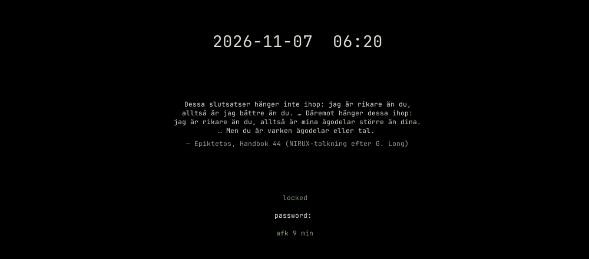

# NIRULOCK

Native X11/PAM lock screen with clock, away time and a themed CAVA spectrum or quotes.

**Status: beta** · Part of the [NIRUX](https://github.com/nirucon/nirux) suite · [MIT License](LICENSE)



## About

NIRULOCK is the lock screen of NIRUX. It authenticates only through PAM, grabs
keyboard and pointer itself and draws a calm, opaque screen in the colours of
the active NIRUX theme: a large clock, how long you have been
away, the password prompt and, while music plays, a live CAVA spectrum. When
it is quiet, it shows a quote from Hávamál or the Stoics instead.

It also publishes `_NIRU_LOCK_READY` once its grabs are verified, which is what
NIRUWM's lock-then-suspend relies on, so the machine never suspends with an
unlocked screen.

## Features

- PAM-only unlock for the process owner; it refuses to start rather than fall
  back to `$USER` or `root`.
- PAM module messages (for example `pam_faillock` lockouts) shown under the
  prompt; failures counted and shown in the theme's warning colour.
- Caps Lock indicator and the active keyboard layout next to the prompt
  (`[SE] password:`) when more than one layout is configured.
- Real XKB input via libxkbcommon (dead keys, AltGr, keypad, compose), loaded
  at run time with a built-in fallback.
- Five layouts: `cava` (default), `minimal`, `terminal`, `runic` and `corner`.
- `visual = "auto"`: CAVA spectrum only while music plays, otherwise rotating
  quotes; CAVA and audio monitoring stop completely with the display off.
- Password-length hiding with `prompt_echo = "pulse"`.
- Every copy of the password is wiped after use; nothing about keys is logged.
- Optional NIRUX sounds through NIRUNOTIFY (`auth-fail`, `lock`, `unlock`,
  and a quiet typewriter click for each password key, `lock-typing`).
- Optional pause music (`[pause_music]`, off by default): Commodore 64 SID
  tunes from `~/Music/SID` through `sidplayfp` while the screen is locked and
  nothing else is playing, by default only when you lock by hand (not on
  idle, suspend or a script's lock). Esc stops it.

## Requirements

- Debian, Arch or Void Linux (glibc), x86_64, with X11.
- PAM and sudo once, to install `/etc/pam.d/nirulock`.
- Optional: [CAVA](https://github.com/karlstav/cava) for the spectrum,
  PipeWire (`pipewire-pulse`) or PulseAudio for music detection,
  libxkbcommon/libxkbcommon-x11 for full keyboard handling, a runic font for
  the `runic` layout.
- Optional, for `[pause_music]`: `sidplayfp` (Debian `sidplayfp`, Void
  `sidplayfp`, Arch: the AUR package `sidplayfp` on top of `libsidplayfp` from
  `extra`) and `dbus-monitor` (stops the music before suspend).
- Building from source: Rust 1.75 or newer, a C linker, PAM development
  headers and a monospace font.

## Installation

### With NIRUX

NIRULOCK is a core component. `nirux install` installs it, including the PAM
service, and `nirux update` keeps it current. See the
[NIRUX README](https://github.com/nirucon/nirux#installation).

### Standalone

The released binary needs no Rust:

```sh
git clone https://github.com/nirucon/nirulock
cd nirulock
./install.sh
```

The installer puts `nirulock` in `~/.local/bin` and asks for sudo to write
`/etc/pam.d/nirulock`, which includes your distribution's normal
authentication stack (templates for Debian, Arch and Void are in `pam/`).

| Option | Effect |
|---|---|
| `--build` | Build from this checkout instead of downloading |
| `--check` | Verify what is installed |
| `--prefix DIR` | Install under `DIR` instead of `~/.local` |
| `--uninstall` | Remove what the installer installed |

## Usage

```sh
nirulock                      # lock now (--lock is accepted and does the same)
nirulock --reason manual      # lock now, saying why (see below)
nirulock --config             # print the effective settings, including the layout
nirulock --version
nirulock --help
```

`--reason` (or the `NIRULOCK_REASON` environment variable; the argument
wins) tells the lock why it was started: `manual`, `idle`, `suspend`,
`script` or `session`. It only decides whether the [pause music](#pause-music)
may play; the lock itself, the grabs and PAM are the same for every reason.
No reason, or one this release does not know, locks normally without pause
music, so an older caller never gets noisier. In NIRUWM the reasons come from
the callers:

| Lock from | Reason |
|---|---|
| `Super+Escape` (NIRUWM `lock` action), the launcher's lock actions and Quick Settings | `manual` |
| `niructl lock` typed in a terminal, or `niructl lock --manual` | `manual` |
| `niructl lock` without a terminal (SSH command, cron, scripts) or `niructl lock --silent` | `script` |
| NIRUIDLE after the screensaver | `idle` |
| Lock before suspend, lid close, `niructl suspend`, `Super+Shift+Escape` | `suspend` |
| An older caller that passes nothing | `unspecified` |

In NIRUWM, `Super+Escape` locks and `Super+Shift+Escape` locks and then
suspends. `niruidle` locks automatically after the screensaver (see `[idle]`
in the NIRUWM config). In NIRUX, `nirux manual lock` describes locking, the
idle ladder and every lock setting.

On the lock screen: type the password and press Enter. Escape clears the
entry (and stops the pause music for the rest of this lock); Backspace first
cancels a pending dead key.

### Layouts

Choose one with `layout`:

| Layout | Composition |
|---|---|
| `cava` | Default. Large clock above the spectrum or a quote; lock state, away time and prompt below |
| `minimal` | Centred clock, lock state, away time and prompt |
| `terminal` | Left-aligned monospace screen with a `~$ lock` line |
| `runic` | The minimal composition with a discreet rune row when a runic font is available (ornamental only) |
| `corner` | Clock top-left, away time at the bottom, prompt centred |

The hostname is not shown unless you set `show_hostname = true`; it then
appears under the clock (`hostname:~$ lock` in `terminal`).

### Music or quotes

`visual` decides what the `cava` layout shows where the spectrum is drawn:

| Value | Shows |
|---|---|
| `auto` | Default. The CAVA spectrum only while music or radio plays, otherwise a quote |
| `cava` | The spectrum alone (CAVA runs whenever the display is on) |
| `quotes` | Quotes alone; CAVA never starts |
| `none` | Nothing; `visualizer = false` without `visual` also means `none` |

A quote changes every minute with a soft fade. The quotes are plain text files
in `~/.config/niru/quotes/`, shared with NIRUSCREENSAVER; see
[docs/QUOTES.md](docs/QUOTES.md) for the format, how to add your own and the
sources of the built-in collections. How the spectrum and music detection
work is described in [docs/BEHAVIOUR.md](docs/BEHAVIOUR.md).

### Pause music

With `[pause_music] enabled = true`, the lock plays Commodore 64 SID tunes
while it is shown, but only for the lock reasons in `on` (default
`["manual"]`: only when you lock by hand; see [Usage](#usage)). An automatic
lock (idle, before suspend, a script or SSH) stays quiet, so a rollout that
locks several machines at once does not start music on all of them. It waits 2 seconds after locking (up to 5 while an idle
stream is present) and starts only if no other audio played in that time and
the folder holds `.sid` files. The tunes play in natural order (`1-`, `2-`,
`10-`), looping, each for its length from the HVSC `Songlengths.md5` when that
file is in the folder (or its `DOCUMENTS` directory), otherwise for
`track_seconds`. While the spectrum is shown it visualises the tune.

A subtle line under the clock or panel names the tune from its PSID/RSID
header: the title, author and year, followed by `Esc stops the music`.

The music stops, and stays stopped for the rest of the lock, on unlock, on
Esc, before suspend and (unless `stop_on_display_off = false`) when the display
goes off. The player is an ordinary `sidplayfp` child process in its own
session (no controlling terminal) with no input; nothing typed on the lock screen reaches it, and
the lock never waits for it. It cannot unlock anything: authentication is
untouched. Without `sidplayfp` the lock logs one line and stays silent. Put your
own tunes in the folder; none are shipped. Details are in
[docs/BEHAVIOUR.md](docs/BEHAVIOUR.md#pause-music-pause_music).

## Configuration

Settings live in `~/.config/niruui/lock.toml` (XDG respected); see
[config.example.toml](config.example.toml).

```toml
layout = "cava"            # cava, minimal, terminal, runic, corner
visualizer = true
visual = "auto"            # auto, cava, quotes, none
quotes = ["*"]             # collections by name; * and ? patterns
prompt_echo = "count"      # count: one * per character (at most 32 shown); pulse: hide the length
show_hostname = false      # true: show the machine name under the clock
font_size = 22.0
# font_path = "/path/to/font.ttf"
# rune_font_path = "/path/to/runic.ttf"

[pause_music]              # off by default
enabled = false
folder = "~/Music/SID"     # .sid files, searched recursively
track_seconds = 180        # per tune without Songlengths.md5 (5 to 3600)
stop_on_display_off = true
on = ["manual"]            # lock reasons that play: manual, idle, suspend, script, session, unspecified

[palette]                  # optional overrides; normally the NIRUX theme decides
background = "000000"
foreground = "e5e5e5"
```

The NIRUX theme controls colours; the layout only controls composition. The
background stays opaque.

## Files and paths

| Path | Purpose |
|---|---|
| `~/.config/niruui/lock.toml` | Lock settings |
| `~/.config/niru/quotes/*.txt` | Quote collections (shared with NIRUSCREENSAVER) |
| `~/Music/SID/` | Tunes for `[pause_music]` (the `folder` setting), optionally with `Songlengths.md5` |
| `/etc/pam.d/nirulock` | PAM service |
| `~/.local/state/nirulock/trace.log` | Diagnostics; never passwords, keycodes or modifiers |
| `~/.local/bin/nirulock` | Program |

## Troubleshooting

- **The right password is rejected.** Check the layout shown next to the
  prompt and the Caps Lock indicator. A PAM lockout message is shown under
  the prompt.
- **The lock refuses to start.** Check `/etc/pam.d/nirulock` exists
  (`./install.sh --check`) and read `~/.local/state/nirulock/trace.log`.
- **No spectrum.** CAVA is not installed, `visual` is `quotes` or `none`, or
  (with `auto`) nothing is playing loud enough.
- **No pause music.** Check `enabled = true`, that `sidplayfp` is installed and
  the folder has `.sid` files; `trace.log` says why it did not start (for
  example "other audio is playing").
- **Suspend does not happen after `Super+Shift+Escape`.** Suspend waits for
  `_NIRU_LOCK_READY`; if the lock could not grab the keyboard, it is refused.
- **Security note.** X11 cannot isolate a lock screen from hostile clients on
  the same display server. Input methods (IBus, Fcitx) are not used while
  locked.

## Uninstall

With NIRUX, use `nirux uninstall`. A standalone install is removed with:

```sh
./install.sh --uninstall
```

## Building from source

```sh
cargo build --release --locked
cargo fmt --check
cargo clippy --all-targets -- -D warnings
cargo test
sh tests/installer.sh
sh tests/resource-check.sh target/release/nirulock
```

`NIRU_CAVA_TRACE=/path/to/file` appends one line per spectrum frame (the
milliseconds since start, `L`ive, `S`ilent or display `O`ff, the sequence
number of the CAVA frame shown, how many milliseconds ago it arrived, and the
48 bar heights) for measuring motion and frame pacing: a repeated or jumping
sequence number is a repeated or skipped frame. It records nothing else.

`tests/compose-unlock.sh` types a password with dead keys and keypad digits in
its own Xvfb; run it as a disposable test account whose password is the
fixture described in the script.

## Status, disclaimer and how it's made

**Status: beta.** NIRULOCK locks all my machines every day; it is
security-sensitive software written for my own use, so read the code and
keep another way to log in while you try it.

NIRUX and every niru* project are made by me, Nicklas Rudolfsson
([@nirucon](https://github.com/nirucon)), for me. They are tailored to my own
needs, preferences and workflows, on my own machines. If they fit yours too,
that's a nice bonus.

- **Free and open source.** Anyone is free to use, study, change and share
  it under the [MIT License](LICENSE).
- **No guarantees.** There is no warranty of any kind. Use it at your own
  risk, read what you install and keep backups of anything that matters.
- **How it's made.** Some of these projects I built from scratch by hand. In
  more recent releases I have used Claude, Anthropic's AI, to do much of the
  heavy lifting under my direction: I decide what to build and how it should
  behave, and I test it on my own machines. It saves me a lot of time, and
  the result is quite OK.
- **Alpha, beta, dev, and maybe forever.** Most things here are alpha, beta
  or dev, and may stay that way. Maybe one day there will be a real stable
  release, but given how fast development moves, and how I am as a person,
  maybe never :)

| Label | Meaning |
|---|---|
| dev | Under active construction; may not build, install or work yet. |
| alpha | Works on my machines, but incomplete or rough; expect breaking changes. |
| beta | In daily use on my machines and mostly complete; rough edges remain. |

## License

MIT License, see [LICENSE](LICENSE). Copyright (c) 2026 Nicklas Rudolfsson.
